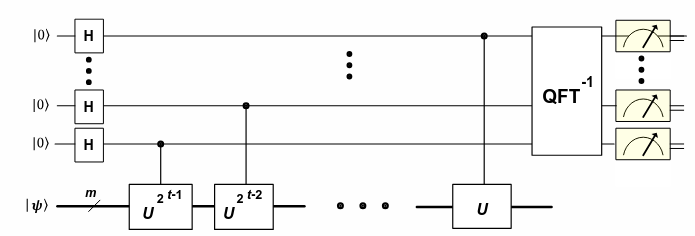
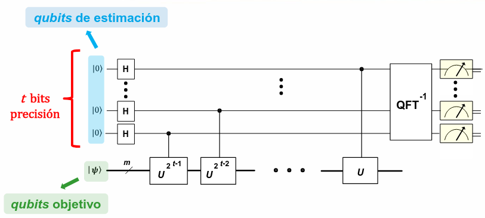
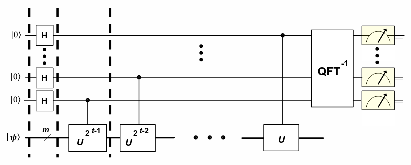
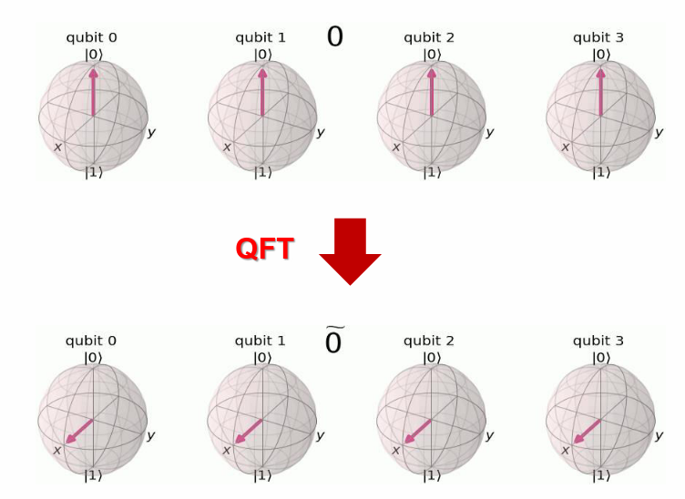
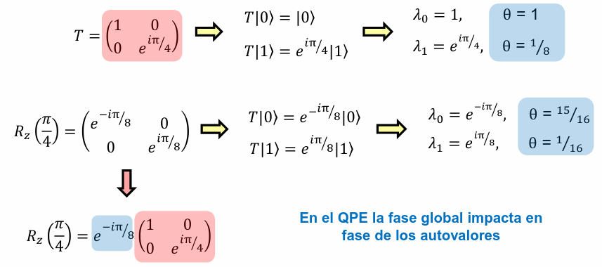

# _Quantum Phase Estimation_ (QPE)

El algoritmo QPE es muy importante en el cómputo cuántica. Permite **estimar la fase cuántica asociada a un autovalor**. Este trabaja con operaciones cuánticas, tales como matrices unitarias, estados cuánticos y autovalores complejos.

Algunas de las aplicaciones del QPE son las siguientes:

- Grover y conteo de soluciones.
- Grover y estimación de ciertas amplitudes.
- Obtención de la energía de un Hamiltoniano para un estado en particular.
- En implementaciones del algoritmo de Shot, una nueva interpretación.
- Alternativa al algoritmo cuántico VQE cuando se supere la era NISQ.
- Entre otras.

En pocas palabras, ¿qué hace el QPE? **Obteniene la fase de autovalor, que es la fase de un número complejo**.

Sea una operador cuántico $U$ (como lo puede ser una compuerta de rotación Z, por ejemplo) de modo que:

$$
Uv = \lambda v
$$

donde:
- $v$ es el autovector; y
- $\lambda$ es el autovalor.

Se puede describir al autovalor en términos de un ángulo $theta$:

$$
\lambda = e^{2\pi i \theta}
$$

{{
::: {.callout-tip}

Si $U$ es una matriz unitaria, los autovalores tienen norma uno.

:::
}}

Así, QPE es el algoritmo que permite obtener $\theta$ con $t$ bits de precisión.

{{
::: {.callout-note}

Una interpretación interesante es que la fase del autovalor es la fase global que adquiere su autovector al aplicar la operación $U$.

:::
}}

A continuación se presenta una imagen con la implementación del algoritmo QPE:

{{
::: {.callout-important}

Importa el orden de las potencias controladas: cada qubit de estimación debe controlar \(U^{2^i}\).

No obstante, sí se puede invertir el orden de aplicación de esas operaciones porque actúan sobre registros de control diferentes y son operaciones que conmutan. De hecho, este orden puede ser útil para después llevar el circuito a Qiskit. Lo importante es mantener la correspondencia correcta entre cada qubit y su potencia.

:::
}}

Así, la aplicación del operador cuántico $U$ a un qubit objetivo puede describirse como:

$$
U|\psi\rangle = e^{2\pi i \theta}|\psi \rangle
$$

Y su aplicación a $k$ qubits objetivos puede describirse como:

$$
U^{k}|\psi\rangle = e^{2\pi i \theta k}|\psi \rangle
$$

## Desglose Matemático de la Implementación

La entrada del algoritmo es la siguiente:

$$
|\psi \rangle | 0 \rangle ^ t
$$

En el siguiente paso, se le aplica Hadamard a todos los qubits de estimación (los $t$ qubits de precisión).

$$
|\psi \rangle (\frac{|0\rangle + |1\rangle}{\sqrt{2}})^t
$$

Si se saca $\sqrt{2^t}$ (luego de aplicar la potencia) como factor común, se obtiene la siguiente expresión:

$$
\frac{|\psi \rangle}{\sqrt{2^t}}(|0\rangle + |1\rangle)(|0\rangle + |1\rangle)..(|0\rangle + |1\rangle)
$$

El siguiente paso del algoritmo, aplica $U^{2^{t-1}}$ a todos los qubits objetivos. Matemáticamente, se tiene:

$$
\frac{|\psi \rangle}{\sqrt{2^t}}(|0\rangle + e^{2 \pi \theta i 2^{t-1}} |1\rangle)(|0\rangle + |1\rangle)..(|0\rangle + |1\rangle)
$$

Luego, se siguen aplicando el resto de los operadores unitarios, cada uno elevado a su respectiva potencia. El resultado final es el siguiente:

$$
\frac{|\psi \rangle}{\sqrt{2^t}}(|0\rangle + e^{2 \pi i \theta 2^{t-1}} |1\rangle)(|0\rangle + e^{2 \pi i \theta 2^{t-2}} |1\rangle)..(|0\rangle + e^{2 \pi i \theta } |1\rangle)
$$

Que puede describirse en términos de sumatoria como:

$$
\frac{\psi}{\sqrt{2^t}}\sum_{k=0}^{2^t - 1}{e^{2 \pi i \theta k} |k\rangle}
$$

Duda -> ¿Acá $k$ no comenzaría a contar desde 1?

Recordar ahora la QFT:

$$
|x\rangle = \frac{1}{\sqrt{N}}\sum_{y=0}^{N-1}{e^{2\pi i \frac{x \cdot y}{N}}}|y\rangle
$$

con $N = 2^t$.

En la transformada cuántica de Fourier (FCC) se pasa de la base computación de los **qubits** a la base de Fourier (fases).

Si $x = 2^t \theta$:

$$
|2^t \theta \rangle \rightarrow{QFT} \frac{1}{\sqrt{2^t}}\sum_{y=0}^{N-1}{e^{2\pi i \frac{2^t \theta y}{2^t}}}|y\rangle
$$

Los $2^t$ se cancelan, obteniendo así:

$$
|2^t \theta \rangle \rightarrow{QFT} \frac{1}{\sqrt{2^t}}\sum_{y=0}^{N-1}{e^{2\pi i \theta y}}|y\rangle
$$

Por consiguiente, al resultado del algoritmo de QPE puede escribirse como:

$$
|\psi \rangle |2^t \theta\rangle
$$

Sin embargo, no nos interesa medir los qubits objetivos objetivos. Ese es el resultado de aplicar el operador cuántico. Lo que nos interesa es obtener la fase. Por consiguiente, solo se miden los qubits de estimación, cuyo resultado es:

$$
|2^t \theta \rangle
$$

**Este último es el valor que se mide**.

A este valor, se lo divide por $2^t$ y se obtiene $\theta$. Así, la fase del autovalor es $2\pi \theta$.

Si $t=4$, entonces:

$$
\theta = \{ 0, \frac{1}{16}, \frac{1}{8}, \frac{3}{16}, ..., \frac{15}{16}\}
$$

**La fase del autovalor está entre $0$ y $2\pi$**.

## Fase Negativa

Podría pasar que la fase del autovalor sea negativa. Por ejemplo:

$$
U = \begin{pmatrix}
1 & 0 \\
0 & e^{\frac{-i\pi}{4}}
\end{pmatrix}

\rightarrow

U|1\rangle = e^{\frac{-i\pi}{4}}|1\rangle
$$

como:

$$
-\frac{\pi}{4} = 2\pi - \frac{\pi}{4} = \frac{7 \pi}{4}
$$

con autovalor de forma:

$$
\lambda = e^{i2\pi\theta}
$$

se obtiene que:

$$
\theta = -\frac{1}{8} = \frac{7}{8}
$$

## QPE a Vector que no es Autovalor de $U$

> ¿Qué sucede si aplico el QPE a un vector (estado) que no es autovector de $U$?

El operador $U$ admite una base ortonormal de autovectores.

Ejemplo:

Sea una base ortonormal de autovectores de $U \rightarrow \{ |v_0\rangle, |v_1 \rangle, |v_2\rangle, |v_3\rangle\}$ con autovalores $\{\lambda_0, \lambda_1, \lambda_2, \lambda_3\}$

$$
| \psi \rangle = \alpha_0 |v_0\rangle + \alpha_1 |v_1\rangle + \alpha_2 |v_2\rangle + \alpha_3 |v_3\rangle
$$

Lo que implica que:

$$
| \psi \rangle = \alpha_0 |\lambda_0\rangle + \alpha_1 |\lambda_1\rangle + \alpha_2 |\lambda_2\rangle + \alpha_3 |\lambda_3\rangle
$$

Es decir, no hay problema si le aplica QPE a un vector que no es autovector de $U$, ya que dicho estado será una combinación lineal de la base ortonormal de autovectores de $U$.

## Fase Global

Hay una particularidad con la fase global.

En el QPE, la fase global impacta en la fase de los autovalores.

$$
T \not = R_z( \frac{\pi}{4})
$$

## Hamiltoniano

El QPE sirve para obtener el valor de energía de un Hamiltoniano.

$$
H|\psi_j\rangle = a_j |\psi_j\rangle
$$

donde:
- $H$ es un operador Hermítico.
- $\psi_j$ es un autovector.
- $a_j$ es un autovalor real.

**QPE no puede encontrar el autovalor de $H$**. Esto se debe a que el autovalor es real.

No obtante, si:

$$
U = e^{-iHt}
$$

entonces:

$$
U|\psi_j\rangle = e^{-ia_jt}|\psi_j\rangle
$$

lo que establece que el autovalor del operador unitario $U$ es:

$$
\lambda_j = e^{-ia_jt}
$$

Y para encontrar dicho valor sí se puede usar el QPE. Con este se obtiene que:

$$
\lambda = e^{i2\pi\theta}
$$

Despejando $a_j$ se obtiene:

$$
a_j = \frac{-2\pi\theta_j}{t}
$$

donde $t$ (tiempo) es un valor determinado por el usuario.