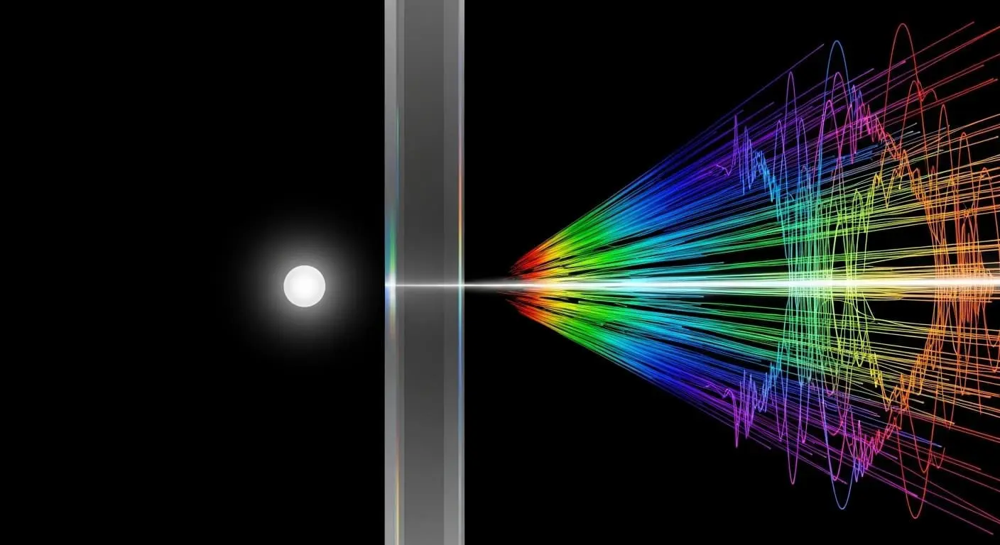
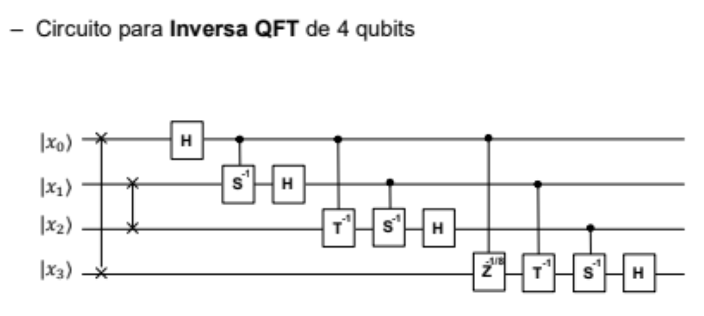
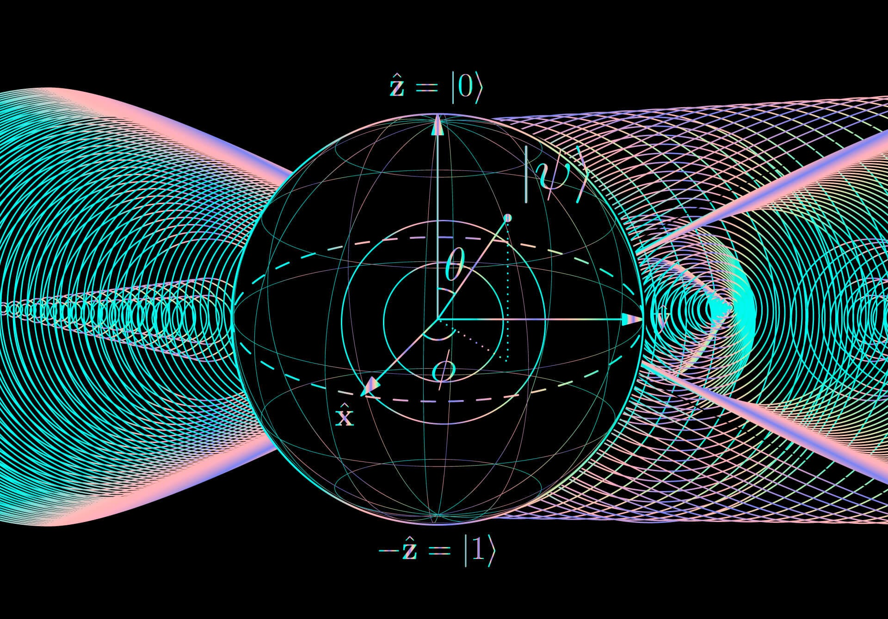

# Introducción

A lo largo de este informe, se presentan el desarrollo, el análisis teórico y los resultados experimentales correspondientes a la resolución de los trabajos prácticos de **Estimación de Fase Cuántica** (_Quantum Phase Estimation_, QPE) y **Búsqueda de Grover** (_Grover's Algorithm_), dictados en el curso.

Para la implementación y simulación de los circuitos cuánticos se utilizó el _framework_ `Qiskit`, junto al lenguaje de programación Python. Si desea acceder al código fuente completo y a las _notebooks_ interactivas (`practicos/qpe.ipynb` y `practicos/grover.ipynb`), estos pueden hallarse en el repositorio de GitHub del proyecto: [https://github.com/iroumec/Quantum-Computing](https://github.com/iroumec/Quantum-Computing).

# Estimación de Fase Cuántica (QPE)

## Fundamento Teórico

El algoritmo de Estimación de Fase Cuántica tiene como propósito estimar el autovalor $e^{2\pi i\theta}$ correspondiente a un autovector $|\psi\rangle$ de un operador unitario $U$, tal que:

$$U|\psi\rangle = e^{2\pi i\theta}|\psi\rangle, \quad \text{con } 0 \le \theta < 1$$

El circuito utiliza dos registros cuánticos: un registro de **estimación** compuesto por $t$ qubits inicializados en superposición uniforme mediante compuertas de Hadamard ($H^{\otimes t}|0\rangle$), y un registro **objetivo** de $m$ qubits preparado en el autoestado $|\psi\rangle$. Mediante aplicaciones sucesivas de compuertas controladas $C\text{-}U^{2^k}$ y la posterior aplicación de la Transformada Cuántica de Fourier Inversa ($\text{QFT}^{-1}$), la fase $\theta$ queda codificada en la base computacional del registro de estimación como una aproximación binaria de $t$ bits: $\tilde{\theta} = \frac{y}{2^t}$.

{#fig-qpe-portada width=80%}

## Ejercicio 1: Operadores de Rotación y Precisión ($t$ y $m$)

> Implementar el algoritmo QPE visto en el curso considerando diferentes operadores unitarios de rotación $U$ y diferentes cantidades de qubits objetivo ($m$) y qubits de estimación ($t$):  
> i. $U \in \{Z, S, T, R_z(\pi), R_z(\pi/2), R_z(\pi/4), R_z(3\pi/4)\}$ con $m = 1$ y $t = 4$.  
> ii. Inciso i) con $m = 2$.  
> iii. Inciso i) con $t = 6$.  
> iv. $U \in \{R_z(-\pi/4), R_z(-3\pi/4)\}$ con $m = 1$ y $t = 4$.

### Transformada Cuántica de Fourier Inversa ($\text{QFT}^{-1}$)

Como bloque fundamental previo a la medición del registro de estimación, se implementó la transformada inversa (`iqft`) reutilizando la lógica de rotaciones de fase controladas `cp` de ángulos $-\pi/2^j$ seguidas de compuertas de Hadamard y operaciones `swap` para invertir el orden de los qubits:

{#fig-iqft4 width=95%}

### Análisis de Resultados por Inciso

- **Inciso i ($m=1, t=4$):** Al preparar el qubit objetivo en $|1\rangle$, los operadores $Z$, $S$ y $T$ presentan fases exactas $\theta = 1/2$, $1/4$ y $1/8$, las cuales pueden representarse exactamente con $t=4$ bits en binario ($1000_2$, $0100_2$ y $0010_2$, respectivamente), colapsando con probabilidad del $100\,\%$ en un único estado. En cambio, para rotaciones como $R_z(\pi/4)$ o $R_z(3\pi/4)$, cuya fase asociada sobre $|1\rangle$ es $\theta = 1/16$ o $3/16$, la representación de 4 bits alcanza el límite de resolución o se distribuye entre los estados adyacentes cuando la fase no es un múltiplo exacto de $1/2^t$.
- **Inciso ii ($m=2, t=4$):** Al aplicar el operador sobre múltiples qubits objetivo en $|11\rangle$, las fases individuales se suman debido a la estructura de producto tensorial ($U \otimes U$), duplicando la fase efectiva acumulada en el _phase kickback_.
- **Inciso iii ($t=6$):** Incrementar el registro de estimación a $t=6$ qubits cuadruplica la resolución de la grilla ($\Delta\theta = 1/64$), permitiendo representar de forma exacta fases que en $t=4$ quedaban truncadas.
- **Inciso iv (Ángulos negativos):** Debido a la periodicidad modular de la fase compleja ($e^{-2\pi i |\theta|} = e^{2\pi i (1 - |\theta|)}$), los ángulos negativos se mapean al complemento $1 - |\theta| \pmod 1$.



# Algoritmo de Búsqueda de Grover

## Fundamento Teórico

El algoritmo de Grover permite encontrar uno o más elementos marcados dentro de un espacio de búsqueda no estructurado de tamaño $N = 2^n$ utilizando únicamente $\mathcal{O}(\sqrt{N})$ evaluaciones del oráculo, lo que representa una aceleración cuadrática respecto a la búsqueda clásica $\mathcal{O}(N)$.

Cada iteración de Grover ($G = D \cdot U_\omega$) se compone de dos etapas:

1. **Oráculo ($U_\omega$):** Invierte la fase de los estados solución $|x\rangle$ tales que $f(x) = 1$, aplicando la transformación $|x\rangle \mapsto (-1)^{f(x)}|x\rangle$.
2. **Operador de Difusión ($D$):** Realiza una inversión sobre la amplitud media mediante el operador $2|s\rangle\langle s| - I$ (o equivalente salvo fase global $I - 2|s\rangle\langle s|$), amplificando constructivamente la probabilidad de medir los estados marcados.

{#fig-grover-portada width=72%}

## Ejercicio 1 y 2: Oráculos Multicontrolados y Número de Iteraciones

> Implementar el algoritmo de Grover con los detectores: (i) `CCZ` de 3 qubits y (ii) `CCCCZ` de 5 qubits, analizando el comportamiento para diferente cantidad de iteraciones Oráculo-Grover.

El número óptimo de iteraciones $r$ para maximizar la probabilidad de éxito con $M$ soluciones en un espacio de $N = 2^n$ estados está dado por:

$$r \approx \left\lfloor \frac{\pi}{4}\sqrt{\frac{N}{M}} \right\rfloor$$

Como se observa en la @tbl-grover-iter, el algoritmo rota el vector de estado un ángulo $(2r+1)\theta$ hacia el subespacio solución (donde $\sin\theta = \sqrt{M/N}$). Si se realizan más iteraciones que el valor óptimo ($r=2$ para $n=3$, y $r=4$ para $n=5$), el estado "se pasa" del eje vertical (_over-rotation_) y la probabilidad de éxito disminuye de forma oscilatoria.

| Iteraciones ($r$) | $N = 8$ ($3$ qubits, estado $|111\rangle$) | $N = 32$ ($5$ qubits, estado $|11111\rangle$) | Comportamiento observado |
|:-----------------:|:------------------------------------------:|:---------------------------------------------:|:------------------------:|
| 1 | $0.781$ ($78.1\,\%$) | $0.258$ ($25.8\,\%$) | Amplificación inicial |
| 2 | **$0.945$ ($94.5\,\%$)** | $0.602$ ($60.2\,\%$) | **Óptimo para $3$ qubits** |
| 3 | $0.330$ ($33.0\,\%$) | $0.897$ ($89.7\,\%$) | Sobrerrotación en $n=3$ |
| 4 | $0.012$ ($1.2\,\%$) | **$0.999$ ($99.9\,\%$)** | **Óptimo para $5$ qubits** |
| 5 | $0.548$ ($54.8\,\%$) | $0.860$ ($86.0\,\%$) | Rebote / Sobrerrotación |

: Probabilidad teórica y experimental de medir el estado marcado en función del número de iteraciones de Grover. {#tbl-grover-iter}

## Ejercicio 3 y 4: Oráculos para Funciones Booleanas

### Función $f(x_2, x_1, x_0) = \bar{x}_2 \cdot x_1 \cdot x_0$ ($M = 1$)

Para implementar este oráculo se utilizó un qubit auxiliar (_ancilla_) $x_3$ preparado en el estado $|-\rangle = H X |0\rangle$. Al negar la entrada $x_2$ con compuertas $X$ antes y después de una compuerta Toffoli multicontrolada (`mcx`), el estado marcado $|011\rangle$ induce una fase $(-1)$ por _phase kickback_. Al haber $M=1$ solución entre $N=8$ estados, el número ideal de iteraciones es $r = \lfloor \frac{\pi}{4}\sqrt{8} \rfloor = 2$.

### Función $f(x_2, x_1, x_0) = \bar{x}_2 \bar{x}_1 x_0 + x_2 x_1 \bar{x}_0$ ($M = 2$)

Esta función booleana marca dos estados solución: $|001\rangle$ y $|110\rangle$ ($M=2$). En consecuencia, la relación $N/M = 8/2 = 4$ reduce el número óptimo de iteraciones a:

$$r = \left\lfloor \frac{\pi}{4}\sqrt{\frac{8}{2}} \right\rfloor = \left\lfloor \frac{\pi}{2} \right\rfloor = 1 \text{ iteración}$$

Con una única iteración del operador de Grover, el ángulo de rotación inicial $\theta = \arcsin(\sqrt{2/8}) = \pi/6$ ($30^\circ$) se triplica a $3\theta = \pi/2$ ($90^\circ$), alcanzando una probabilidad teórica del $100\,\%$ repartida equitativamente ($50\,\%$ en $|001\rangle$ y $50\,\%$ en $|110\rangle$).

# Conclusiones

A lo largo del desarrollo de estos trabajos prácticos, se profundizó en dos de los algoritmos más emblemáticos de la computación cuántica: la Estimación de Fase Cuántica (QPE) y la búsqueda de Grover. Su implementación en Qiskit permitió verificar empíricamente fenómenos puramente cuánticos como el _phase kickback_, la interferencia constructiva y destructiva de amplitudes, y el carácter periódico de las rotaciones en el subespacio de Hilbert.

# Referencias

[1] M. A. Nielsen and I. L. Chuang, _Quantum Computation and Quantum Information: 10th Anniversary Edition_, Cambridge University Press, 2010.

[2] “Phase Estimation and Grover's Algorithm — Qiskit Documentation”, IBM Quantum, [Online]. Disponible en: [https://quantum.cloud.ibm.com/docs/es](https://quantum.cloud.ibm.com/docs/es) (consultado: nov. 2026).
