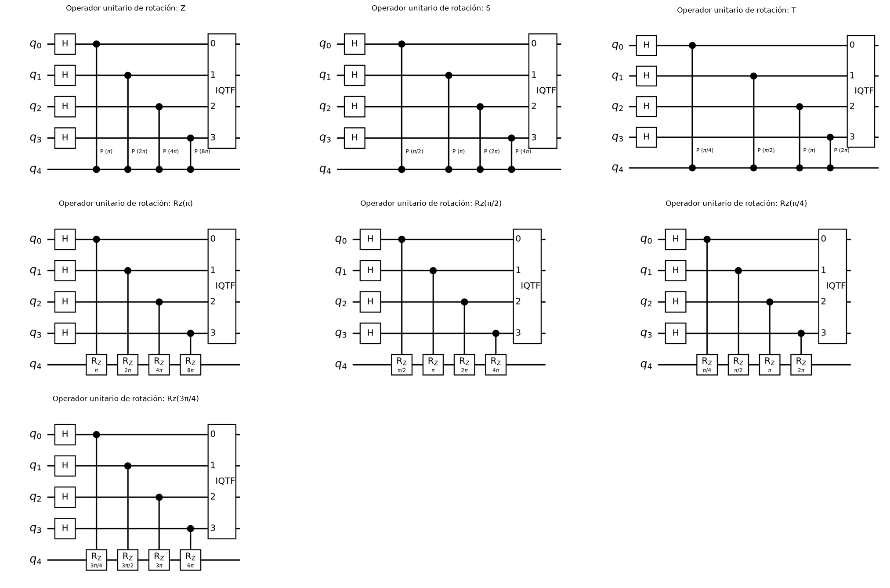
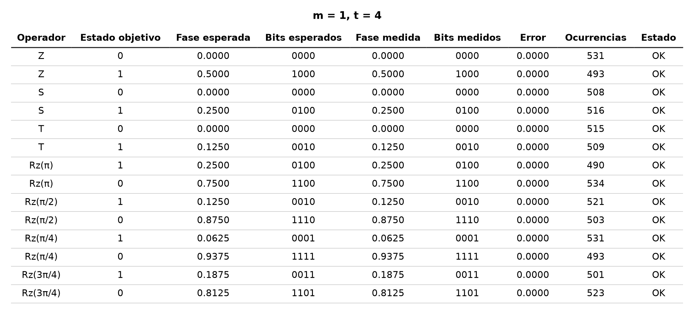
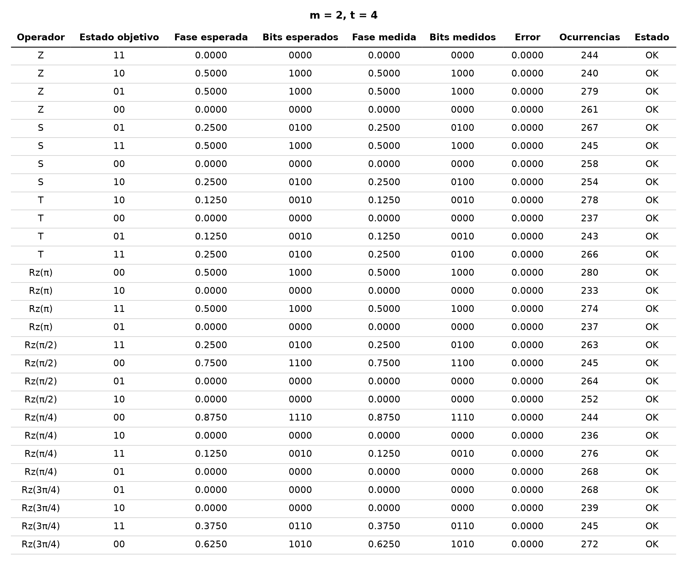
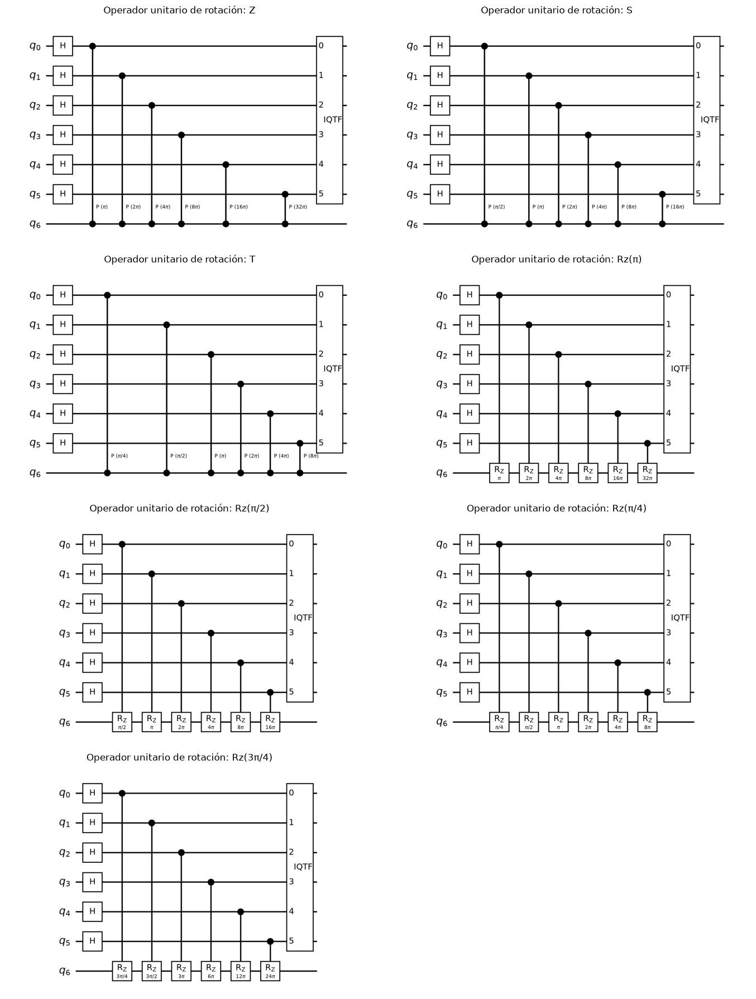
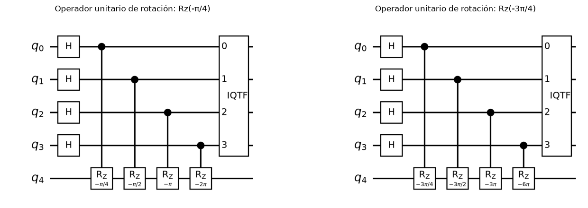
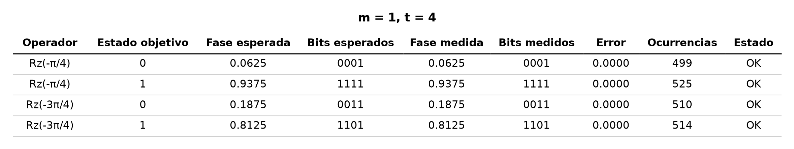
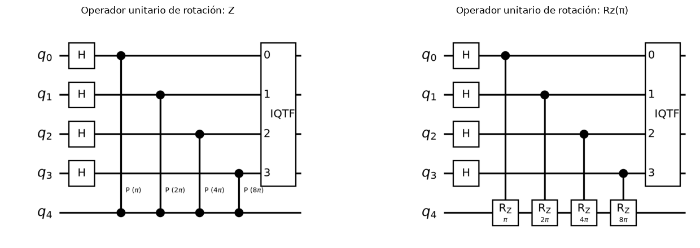
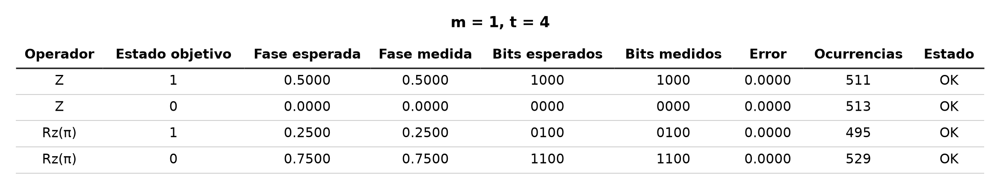

# Introducción

A lo largo de este informe, se presentan el desarrollo, el análisis teórico y los resultados experimentales correspondientes a la resolución de los trabajos prácticos de **Estimación de Fase Cuántica** (_Quantum Phase Estimation_, QPE) y **Búsqueda de Grover** (_Grover's Algorithm_), dictados en el curso.

Para la implementación y simulación de los circuitos cuánticos se utilizó el _framework_ `Qiskit`, junto al lenguaje de programación Python. Si desea acceder al código fuente completo y a las _notebooks_ interactivas (`practicos/qpe.ipynb` y `practicos/grover.ipynb`), estos pueden hallarse en el repositorio de GitHub del proyecto: [https://github.com/iroumec/Quantum-Computing](https://github.com/iroumec/Quantum-Computing).



# Estimación de Fase Cuántica (QPE)

## Fundamento Teórico

El algoritmo de Estimación de Fase Cuántica tiene como propósito estimar el autovalor $e^{2\pi i\theta}$ correspondiente a un autovector $|\psi\rangle$ de un operador unitario $U$, tal que:

$$U|\psi\rangle = e^{2\pi i\theta}|\psi\rangle, \quad \text{con } 0 \le \theta < 1$$

El circuito utiliza dos registros cuánticos: un registro de **estimación** compuesto por $t$ qubits inicializados en superposición uniforme mediante compuertas de Hadamard ($H^{\otimes t}|0\rangle$), y un registro **objetivo** de $m$ qubits preparado en el autoestado $|\psi\rangle$. Mediante aplicaciones sucesivas de compuertas controladas $C\text{-}U^{2^k}$ y la posterior aplicación de la Transformada Cuántica de Fourier Inversa ($\text{QFT}^{-1}$), la fase $\theta$ queda codificada en la base computacional del registro de estimación como una aproximación binaria de $t$ bits: $\tilde{\theta} = \frac{y}{2^t}$.

{#fig-qpe-portada width=80%}

## Paso Previo: QFT

Previo a implementar el QPE, es necesario implementar la transformada cuántica de Fourier inversa. Esto se debe a que QPE hace uso de ella.

Para su implementación, se tomó la resolución de la cursada de la materia previa "Fundamentos de la Computación Cuántica".

{#fig-qft4 width=95%}

## Circuitos

Posteriormente, se implementó una función que, dado un operador unitario, construya su QPE correspondiente. A continuación, se presentan los circuitos resultantes para los operadores unitarios descritos en el inciso i del ejercicio.

## Ejercicio 1

La consigna del ejercicio es la siguiente:

> Implementar el algoritmo QPE visto en el curso considerando diferentes operadores unitarios de rotación $U$ y diferentes cantidades de qubits objetivo ($m$) y qubits de estimación ($t$):  
> i. $U \in \{Z, S, T, R_z(\pi), R_z(\pi/2), R_z(\pi/4), R_z(3\pi/4)\}$ con $m = 1$ y $t = 4$.  
> ii. Inciso i) con $m = 2$.  
> iii. Inciso i) con $t = 6$.  
> iv. $U \in \{R_z(-\pi/4), R_z(-3\pi/4)\}$ con $m = 1$ y $t = 4$.

### Inciso i)

Utilizando las funciones construidas anteriormente, se realizó la implementación del algoritmo QPE considerando los operadores unitarios mostrados y $m=1$ y $t=4$.

Todos los operadores unitarios utilizados son diagonales en la base computacional $\{\vert{}0\rangle, \vert{}1\rangle\}$. Por lo tanto, tanto $\vert{}0\rangle$ como $\vert{}1\rangle$ son autovectores de $U$ para un qubit y funcionan como entrada válida del circuito.

A continuación, se presentan los circuitos implementados:

Los resultados obtenidos de la evaluación de los anteriores circuitos se muestran a continuación:

Como puede observarse, al preparar el qubit objetivo en $|1\rangle$, los operadores $Z$, $S$ y $T$ presentan fases exactas $\theta = 1/2$, $1/4$ y $1/8$, las cuales pueden representarse exactamente con $t=4$ bits en binario ($1000_2$, $0100_2$ y $0010_2$, respectivamente), colapsando con probabilidad del $100\,\%$ en un único estado. Lo mismo sucede para las rotaciones $R_z(\pi/4)$ y $R_z(3\pi/4)$, cuya fase asociada sobre $|1\rangle$ es $\theta = 1/16$ y $3/16$, respectivamente. La representación de 4 bits es suficiente ya que la fase es un múltiplo exacto de $1/2^t$.

### Inciso ii)

Mismas instrucciones que para el inciso i), pero utilizando $m = 2$ en lugar de $m = 1$. A continuación, se presentan las implementaciones de los circuitos:

A continuación, se presentan los resultados.

Cuando $m = 2$, el espacio objetivo es de dos qubits y el operador total actúa como un producto tensorial de operadores diagonales sobre cada qubit. Como cada estado de la base computacional de 2 qubits es un producto tensorial de autovectores de un solo qubit (por ejemplo, $\vert{}01\rangle = \vert{}0\rangle \otimes \vert{}1\rangle$), cada uno de los cuatro estados ($\vert{}00\rangle, \vert{}01\rangle, \vert{}10\rangle, \vert{}11\rangle$) es también un autovector del operador conjunto sobre los $m$ qubits objetivo y estos autovectores funcionan como entrada válida del circuito. Se aclara esto porque, de no cumplir los operadores unitarios esta propiedad, sería necesario observar mediante un histograma los valores de $\theta$ obtenidos para distintos shots del circuito. De observarse que no siempre se elige un mismo valor, sería un indicio de que dicho autoestado enviado como entrada al circuito mediante los qubits objetivo no es un autovector del operador y, por consiguiente, no es válido aplicarle el algoritmo.

Al aplicar el operador sobre múltiples qubits objetivo en $|11\rangle$, las fases individuales se suman debido a la estructura de producto tensorial ($U \otimes U$), duplicando la fase efectiva acumulada en el _phase kickback_.

### Inciso iii)

Mismas instrucciones que para el inciso i), pero modificando el valor de $t$ de $t = 4$ a $t = 6$.

Incrementar el registro de estimación a $t=6$ qubits cuadruplica la resolución de la grilla ($\Delta\theta = 1/64$), permitiendo representar de forma exacta fases que en $t=4$ quedaban truncadas. No obstante, en el práctico, todas las fases obtenidas pueden representarse con 4 bits de estimación. Por consiguiente, como puede observarse, el resultado no varía con respecto al inciso i). Los últimos qubits de estimación añadidos no son utilizados. Estos qubits no mejoran la aproximación, pues esta ya es precisa. El incremento de los bits de estimación ($t$) de 4 a 6 no presenta una mejora en la precisión del valor de $\theta$ buscado.

### Inciso iv)

El inciso pide, utilizando $m = 1$ y $t = 4$, probar la implementación para un nuevo conjunto de operadores unitarios:

- $U = Rz(-𝝅/4)$; y
- $U = Rz(-3𝝅/4)$.

Los operadores unitarios presentados anteriormente se caracterizan por tener ángulos negativos. A continuación, se presenta la implementación de sus circuitos:

Estos operadores, al igual que los utilizados en el inciso i), son diagonales en la base computacional y, por lo tanto, las entradas $\vert{}0\rangle$ y $\vert{}1\rangle$ son entradas válidas entrada válido del c

Debido a la periodicidad modular de la fase compleja ($e^{-2\pi i |\theta|} = e^{2\pi i (1 - |\theta|)}$), los ángulos negativos se mapean al complemento $1 - |\theta| \pmod 1$.

## Ejercicio 2

Este ejercicio pide analizar, para el ejercicio 1.i), el impacto de la fase global de los autovalores. Para ello, se deicdió comparar el circuito con los operadores unitarios de rotación $Z$ y $Rz(\pi)$. Esto se debe a que estos operadores, presentes en el ejercicio 1.i), solo se diferencian entre sí en su fase global.

A continuación, se recuerda la implementación del circuito para ambos operadores unitarios:

A continuación, se muestran los resultados obtenidos:

Ambos operadores de rotación realizan una rotación $\pi$ sobre el eje Z. No obstante, $Rz(\pi)$ difiere de $Z$ en una fase global:

$$
Rz(\pi) = \begin{pmatrix} e^{-i\pi/2} & 0 \\ 0 & e^{i\pi/2} \end{pmatrix} = \begin{pmatrix} -i & 0 \\ 0 & i \end{pmatrix} = -i\,Z
$$

Si estas compuertas se aplicaran a un qubit y se realizara la medición, las probabilidades observadas serían las mismas para cualquier estado, ya que una fase global no es observable. Sin embargo, como se observa en la tabla anterior, esto no se cumple en el circuito QPE.

Los autovalores de $Z$ son $1$ y $-1$, mientras que los de $Rz(\pi)$ son $-i$ y $i$. Es decir, la fase global $e^{-i\pi/2}$ multiplica ambos autovalores, lo que desplaza las dos fases estimadas en $-0.25$ (módulo 1). La diferencia entre las fases de $\lvert 0 \rangle$ y $\lvert 1 \rangle$ se mantiene en $0.5$.

Esto ocurre porque el QPE utiliza el operador controlado. Cuando el qubit de control está en $\lvert 1 \rangle$, se aplica $U$ al objetivo, y cuando está en $\lvert 0 \rangle$, no se aplica nada. Por lo tanto, la fase global de $U$ deja de ser global y pasa a ser una fase relativa entre $\lvert 0 \rangle$ y $\lvert 1 \rangle$ del qubit de control (_phase kickback_), que es justamente lo que el QPE estima.

En conclusión, la fase global no afecta las probabilidades de medición de un estado, pero sí la fase estimada por el QPE, por lo que el operador debe especificarse con su fase global incluida.



# Algoritmo de Búsqueda de Grover

## Fundamento Teórico

El algoritmo de Grover permite encontrar uno o más elementos marcados dentro de un espacio de búsqueda no estructurado de tamaño $N = 2^n$ utilizando únicamente $\mathcal{O}(\sqrt{N})$ evaluaciones del oráculo, lo que representa una aceleración cuadrática respecto a la búsqueda clásica $\mathcal{O}(N)$.

Cada iteración de Grover ($G = D \cdot U_\omega$) se compone de dos etapas:

1. **Oráculo ($U_\omega$):** Invierte la fase de los estados solución $|x\rangle$ tales que $f(x) = 1$, aplicando la transformación $|x\rangle \mapsto (-1)^{f(x)}|x\rangle$.
2. **Operador de Difusión ($D$):** Realiza una inversión sobre la amplitud media mediante el operador $2|s\rangle\langle s| - I$ (o equivalente salvo fase global $I - 2|s\rangle\langle s|$), amplificando constructivamente la probabilidad de medir los estados marcados.

{#fig-grover-portada width=72%}

## Ejercicio 1 y 2: Oráculos Multicontrolados y Número de Iteraciones

> Implementar el algoritmo de Grover con los detectores: (i) `CCZ` de 3 qubits y (ii) `CCCCZ` de 5 qubits, analizando el comportamiento para diferente cantidad de iteraciones Oráculo-Grover.

El número óptimo de iteraciones $r$ para maximizar la probabilidad de éxito con $M$ soluciones en un espacio de $N = 2^n$ estados está dado por:

$$r \approx \left\lfloor \frac{\pi}{4}\sqrt{\frac{N}{M}} \right\rfloor$$

Como se observa en la @tbl-grover-iter, el algoritmo rota el vector de estado un ángulo $(2r+1)\theta$ hacia el subespacio solución (donde $\sin\theta = \sqrt{M/N}$). Si se realizan más iteraciones que el valor óptimo ($r=2$ para $n=3$, y $r=4$ para $n=5$), el estado "se pasa" del eje vertical (_over-rotation_) y la probabilidad de éxito disminuye de forma oscilatoria.

| Iteraciones ($r$) | $N = 8$ ($3$ qubits, estado $|111\rangle$) | $N = 32$ ($5$ qubits, estado $|11111\rangle$) | Comportamiento observado |
|:-----------------:|:------------------------------------------:|:---------------------------------------------:|:------------------------:|
| 1 | $0.781$ ($78.1\,\%$) | $0.258$ ($25.8\,\%$) | Amplificación inicial |
| 2 | **$0.945$ ($94.5\,\%$)** | $0.602$ ($60.2\,\%$) | **Óptimo para $3$ qubits** |
| 3 | $0.330$ ($33.0\,\%$) | $0.897$ ($89.7\,\%$) | Sobrerrotación en $n=3$ |
| 4 | $0.012$ ($1.2\,\%$) | **$0.999$ ($99.9\,\%$)** | **Óptimo para $5$ qubits** |
| 5 | $0.548$ ($54.8\,\%$) | $0.860$ ($86.0\,\%$) | Rebote / Sobrerrotación |

: Probabilidad teórica y experimental de medir el estado marcado en función del número de iteraciones de Grover. {#tbl-grover-iter}

## Ejercicio 3 y 4: Oráculos para Funciones Booleanas

### Función $f(x_2, x_1, x_0) = \bar{x}_2 \cdot x_1 \cdot x_0$ ($M = 1$)

Para implementar este oráculo se utilizó un qubit auxiliar (_ancilla_) $x_3$ preparado en el estado $|-\rangle = H X |0\rangle$. Al negar la entrada $x_2$ con compuertas $X$ antes y después de una compuerta Toffoli multicontrolada (`mcx`), el estado marcado $|011\rangle$ induce una fase $(-1)$ por _phase kickback_. Al haber $M=1$ solución entre $N=8$ estados, el número ideal de iteraciones es $r = \lfloor \frac{\pi}{4}\sqrt{8} \rfloor = 2$.

### Función $f(x_2, x_1, x_0) = \bar{x}_2 \bar{x}_1 x_0 + x_2 x_1 \bar{x}_0$ ($M = 2$)

Esta función booleana marca dos estados solución: $|001\rangle$ y $|110\rangle$ ($M=2$). En consecuencia, la relación $N/M = 8/2 = 4$ reduce el número óptimo de iteraciones a:

$$r = \left\lfloor \frac{\pi}{4}\sqrt{\frac{8}{2}} \right\rfloor = \left\lfloor \frac{\pi}{2} \right\rfloor = 1 \text{ iteración}$$

Con una única iteración del operador de Grover, el ángulo de rotación inicial $\theta = \arcsin(\sqrt{2/8}) = \pi/6$ ($30^\circ$) se triplica a $3\theta = \pi/2$ ($90^\circ$), alcanzando una probabilidad teórica del $100\,\%$ repartida equitativamente ($50\,\%$ en $|001\rangle$ y $50\,\%$ en $|110\rangle$).



# Conclusiones

A lo largo del desarrollo de estos trabajos prácticos, se profundizó en dos de los algoritmos más emblemáticos de la computación cuántica: la Estimación de Fase Cuántica (QPE) y la búsqueda de Grover. Su implementación en Qiskit permitió verificar empíricamente fenómenos puramente cuánticos como el _phase kickback_, la interferencia constructiva y destructiva de amplitudes, y el carácter periódico de las rotaciones en el subespacio de Hilbert.











## Recursos específicos

- Video de la clase de QPE: [https://www.youtube.com/watch?v=BeXcnjBtEto](https://www.youtube.com/watch?v=BeXcnjBtEto)
- _Phase kickback_: [https://en.wikipedia.org/wiki/Phase_kickback](https://en.wikipedia.org/wiki/Phase_kickback)
- Estimación de fase cuántica: [https://es.wikipedia.org/wiki/Algoritmo_cu%C3%A1ntico_de_estimaci%C3%B3n_de_fase](https://es.wikipedia.org/wiki/Algoritmo_cu%C3%A1ntico_de_estimaci%C3%B3n_de_fase)
- Algoritmo de Grover: [https://es.wikipedia.org/wiki/Algoritmo_de_Grover](https://es.wikipedia.org/wiki/Algoritmo_de_Grover)

