# Introducción

A lo largo de este informe, se presentan el desarrollo, el análisis teórico y los resultados experimentales correspondientes a la resolución de los trabajos prácticos de **Estimación de Fase Cuántica** (_Quantum Phase Estimation_, QPE) y **Búsqueda de Grover** (_Grover's Algorithm_), dictados en el curso.

Para la implementación y simulación de los circuitos cuánticos se utilizó el _framework_ `Qiskit`, junto al lenguaje de programación Python. El código y las _notebooks_ interactivas se encuentran adjuntos junto con este informe. También puede acceder a estos a través del repositorio de GitHub del proyecto: [https://github.com/iroumec/Quantum-Computing](https://github.com/iroumec/Quantum-Computing), en `practicos/qpe.ipynb` y `practicos/grover.ipynb`.



# Estimación de Fase Cuántica (QPE)

## Fundamento Teórico

El algoritmo de Estimación de Fase Cuántica tiene como propósito estimar el autovalor $e^{2\pi i\theta}$ correspondiente a un autovector $|\psi\rangle$ de un operador unitario $U$, tal que:

$$U|\psi\rangle = e^{2\pi i\theta}|\psi\rangle, \quad \text{con } 0 \le \theta < 1$$

El circuito utiliza dos registros cuánticos: un registro de **estimación** compuesto por $t$ qubits inicializados en superposición uniforme mediante compuertas de Hadamard ($H^{\otimes t}|0\rangle$), y un registro **objetivo** de $m$ qubits preparado en el autoestado $|\psi\rangle$. Mediante aplicaciones sucesivas de compuertas controladas $C\text{-}U^{2^k}$ y la posterior aplicación de la Transformada Cuántica de Fourier Inversa ($\text{QFT}^{-1}$), la fase $\theta$ queda codificada en la base computacional del registro de estimación como una aproximación binaria de $t$ bits: $\tilde{\theta} = \frac{y}{2^t}$.

Con base en lo anterior, se presentan en las siguientes secciones la resolución de los ejercicios prácticos propuestos por la cátedra de la materia.

## Pasos Previos

Previo a implementar el QPE, es necesario implementar la transformada cuántica de Fourier inversa. Esto se debe a que el algoritmo QPE hace uso de ella. Para su implementación, se tomó la resolución de la cursada de la materia previa "Fundamentos de la Computación Cuántica". Esta consistía en una función que, dado un número de qubits como parámetro, generaba el circuito de la transformada cuántica de Fourier inversa considerando dicho número de qubits. A continuación, se presenta un ejemplo del circuito generado para 4 qubits.

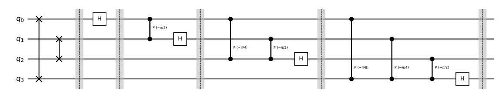{width=90%}

Adicionalmente, para automatizar la resolución, se definió una función capaz de generar el algoritmo para un conjunto de operadores unitarios, un $m$ y un $t$ recibidos como parámetro. Esta se utiliza a lo largo de la resolución de los ejercicios de este práctico.

Con los pasos previos realizados, se prosigue con la resolución de los ejercicios.



## Ejercicio 1

El ejercicio pide implementar el algoritmo QPE visto en el curso considerando diferentes operadores unitarios de rotación $U$ y diferentes cantidades de qubits objetivo ($m$) y qubits de estimación ($t$), dependiendo del inciso en concreto. A continuación, se presenta la resolución para cada uno de los incisos.

### Inciso i)

El inciso pide implementar el algoritmo QPE para $U \in \{Z, S, T, R_z(\pi), R_z(\pi/2), R_z(\pi/4), R_z(3\pi/4)\}$ con $m = 1$ y $t = 4$. Utilizado lo definido anteriormente, se construyen los circuitos correspondientes. A continuación, estos se presentan:

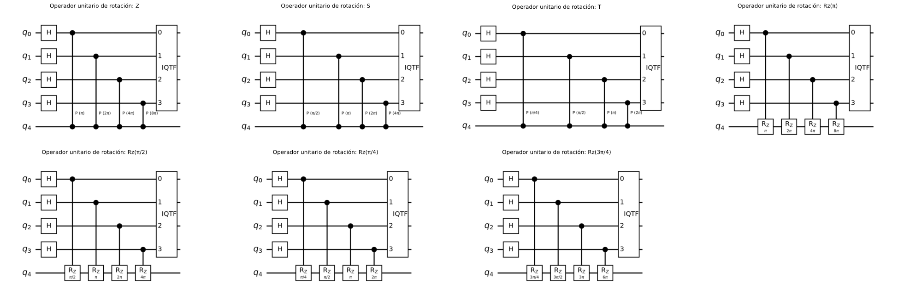{width=80%}

Todos los operadores unitarios utilizados son diagonales en la base computacional $\{|0\rangle, |1\rangle\}$. Por lo tanto, tanto $|0\rangle$ como $|1\rangle$ son autovectores de $U$ para un qubit y funcionan como entrada válida del circuito.

Los resultados obtenidos de la evaluación de los anteriores circuitos se muestran a continuación:

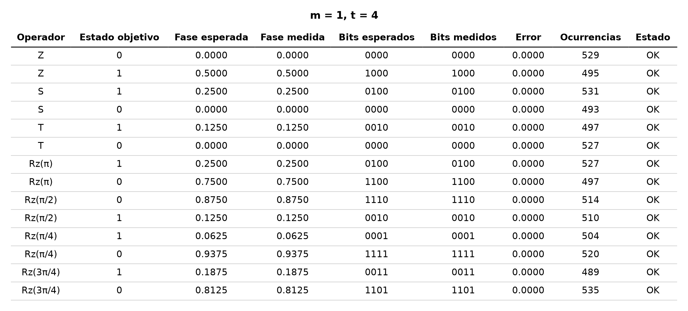{width=80%}

Como puede observarse, al preparar el qubit objetivo en $|1\rangle$, los operadores $Z$, $S$ y $T$ presentan fases exactas $\theta = 1/2$, $1/4$ y $1/8$, las cuales pueden representarse exactamente con $t=4$ bits en binario ($1000_2$, $0100_2$ y $0010_2$, respectivamente), colapsando con probabilidad del $100\,\%$ en un único estado. Lo mismo sucede para las rotaciones $R_z(\pi/4)$ y $R_z(3\pi/4)$, cuya fase asociada sobre $|1\rangle$ es $\theta = 1/16$ y $3/16$, respectivamente. La representación de 4 bits es suficiente ya que la fase es un múltiplo exacto de $1/2^t$.

### Inciso ii)

Las instrucciones de este inciso son las mismas que para el anterior; pero utilizando $m = 2$ en lugar de $m = 1$. A continuación, siguiendo el mismo procedimiento, se presentan las implementaciones de los circuitos:

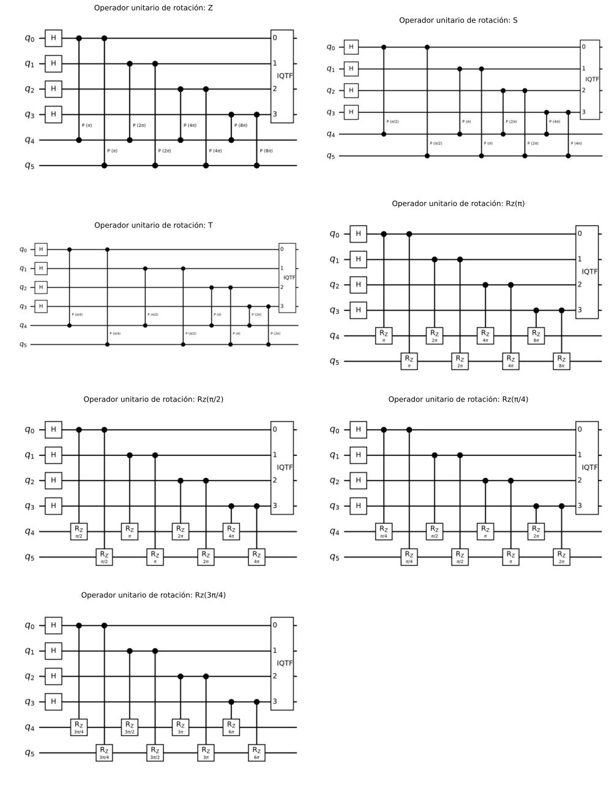{width=80%}

A continuación, se presentan los resultados.

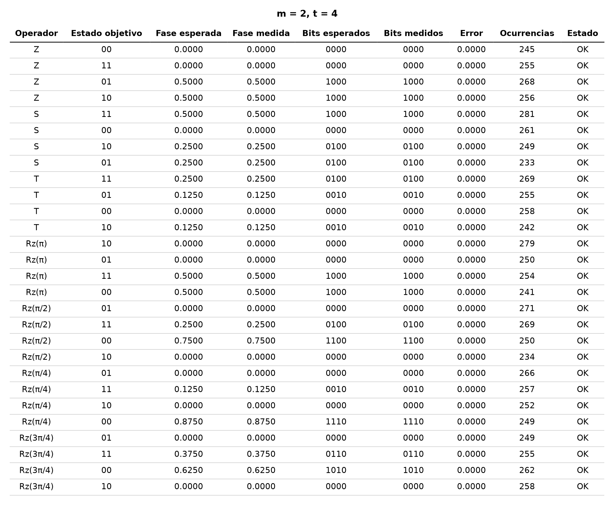{width=80%}

Cuando $m = 2$, el espacio objetivo es de dos qubits y el operador total actúa como un producto tensorial de operadores diagonales sobre cada qubit. Como cada estado de la base computacional de 2 qubits es un producto tensorial de autovectores de un solo qubit (por ejemplo, $\vert{}01\rangle = \vert{}0\rangle \otimes \vert{}1\rangle$), cada uno de los cuatro estados ($\vert{}00\rangle, \vert{}01\rangle, \vert{}10\rangle, \vert{}11\rangle$) es también un autovector del operador conjunto sobre los $m$ qubits objetivo y, por consiguiente, estos autovectores funcionan como entrada válida del circuito. Se aclara esto porque, de no cumplir los operadores unitarios esta propiedad, sería necesario observar mediante un histograma los valores de $\theta$ obtenidos para distintos shots del circuito. De observarse que no siempre se elige un mismo valor, sería un indicio de que dicho autoestado enviado como entrada al circuito mediante los qubits objetivo no es un autovector del operador y, por consiguiente, no es válido aplicarle el algoritmo. Así, siendo estos autovectores válidos, al aplicar el operador sobre múltiples qubits objetivo en $|11\rangle$, las fases individuales se suman debido a la estructura de producto tensorial ($U \otimes U$), duplicando la fase efectiva acumulada en el _phase kickback_. Por ello, si se realiza la comparación con el inciso i), se observa, por ejemplo, que la fase del estado $|11\rangle$ es dos veces la fase del estado $|1\rangle$ obtenida en el inciso anterior.

### Inciso iii)

Las instrucciones de este inciso son las mismas que las del inciso i); pero modificando el valor de $t$ de $t = 4$ a $t = 6$. A continuación, se presenta la implementación de los circuitos:

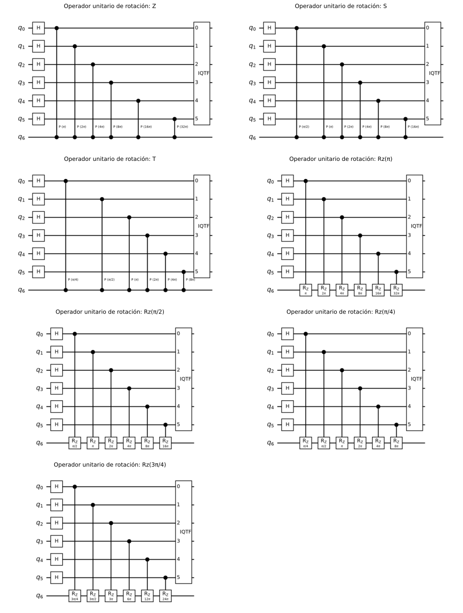{width=80%}

A continuación, se presentan los resultados de la evaluación de los circuitos previos:

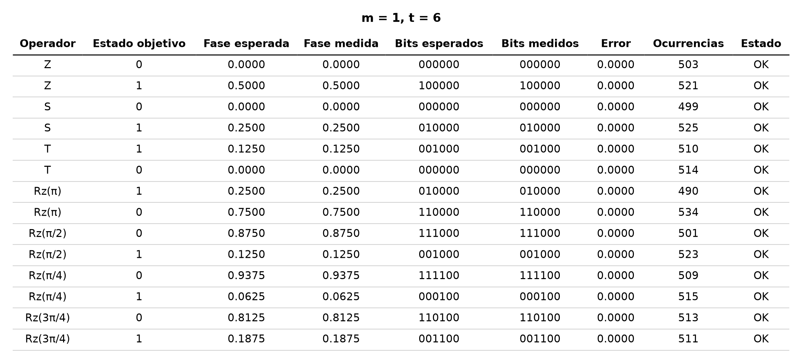{width=80%}

Incrementar el registro de estimación a $t=6$ qubits cuadruplica la resolución de la grilla ($\Delta\theta = 1/64$), permitiendo representar de forma exacta fases que en $t=4$ quedaban truncadas. No obstante, en el práctico, **todas las fases obtenidas pueden representarse con 4 bits de estimación**. Por consiguiente, como puede observarse, el resultado no varía con respecto al inciso i). Los últimos qubits de estimación añadidos no son utilizados. Estos qubits no mejoran la aproximación, pues esta ya es precisa. Así, se concluye que el incremento de los bits de estimación ($t$) de 4 a 6 no presenta una mejora en la precisión del valor de $\theta$ buscado.

### Inciso iv)

Este inciso pide, utilizando $m = 1$ y $t = 4$, probar la implementación para un nuevo conjunto de operadores unitarios:

- $U = Rz(-𝝅/4)$; y
- $U = Rz(-3𝝅/4)$.

Los operadores unitarios presentados anteriormente se caracterizan por tener ángulos negativos. A continuación, se presenta la implementación de sus circuitos:

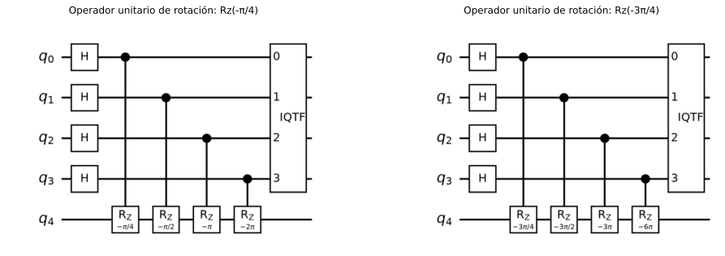{width=80%}

Estos operadores, al igual que los utilizados en el inciso i), son diagonales en la base computacional y, por lo tanto, las entradas $\vert{}0\rangle$ y $\vert{}1\rangle$ son entradas válidas entrada válido del c

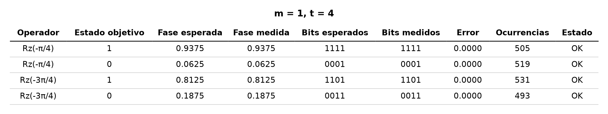{width=80%}

Debido a la periodicidad modular de la fase compleja ($e^{-2\pi i |\theta|} = e^{2\pi i (1 - |\theta|)}$), los ángulos negativos se mapean al complemento $1 - |\theta| \pmod 1$. Así, los valores para el operador $Rz(-𝝅/4)$ para los autovectores $0$ y $1$ coinciden con los obtenidos en el inciso i) para el operador $Rz(𝝅/4)$, pero intercambiando las fases obtenidas para $0$ y $1$. Lo mismo sucede con el operador $Rz(-3𝝅/4)$ y el operador $Rz(3𝝅/4)$ del inciso i).



## Ejercicio 2

Este ejercicio pide analizar, para el ejercicio 1.i), el impacto de la fase global de los autovalores. Para ello, se decidió comparar el circuito con los operadores unitarios de rotación $Z$ y $Rz(\pi)$. Esto se debe a que estos operadores, presentes en el ejercicio 1.i), solo se diferencian entre sí en su fase global y considero que es la forma más directa de notar su efecto.

A continuación, se recuerda la implementación del circuito para ambos operadores unitarios:

{#fig-qpe-resolucion width=90%}

A continuación, se muestran los resultados obtenidos:

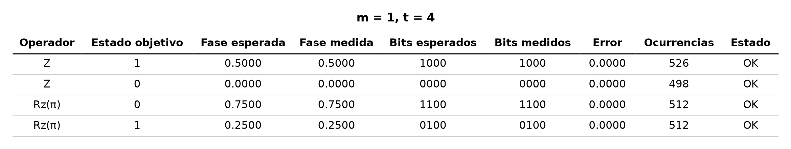{#fig-qpe-resolucion-2 width=90%}

Ambos operadores de rotación realizan una rotación $\pi$ sobre el eje Z. No obstante, $Rz(\pi)$ difiere de $Z$ en una fase global:

$$
Rz(\pi) = \begin{pmatrix} e^{-i\pi/2} & 0 \\ 0 & e^{i\pi/2} \end{pmatrix} = \begin{pmatrix} -i & 0 \\ 0 & i \end{pmatrix} = -i\,Z
$$

Si estas compuertas se aplicaran a un qubit y se realizara la medición, las probabilidades observadas serían las mismas para cualquier estado, ya que una fase global no es observable. Sin embargo, como se observa en la tabla anterior, esto no se cumple en el circuito QPE.

Los autovalores de $Z$ son $1$ y $-1$, mientras que los de $Rz(\pi)$ son $-i$ y $i$. Es decir, la fase global $e^{-i\pi/2}$ multiplica ambos autovalores, lo que desplaza las dos fases estimadas en $-0.25$ (módulo 1). La diferencia entre las fases de $\lvert 0 \rangle$ y $\lvert 1 \rangle$ se mantiene en $0.5$.

Esto ocurre porque el QPE utiliza el operador controlado. Cuando el qubit de control está en $\lvert 1 \rangle$, se aplica $U$ al objetivo, y cuando está en $\lvert 0 \rangle$, no se aplica nada. Por lo tanto, la fase global de $U$ deja de ser global y pasa a ser una fase relativa entre $\lvert 0 \rangle$ y $\lvert 1 \rangle$ del qubit de control (_phase kickback_), que es justamente lo que el QPE estima.

En conclusión, la fase global no afecta las probabilidades de medición de un estado, pero sí la fase estimada por el QPE, por lo que el operador debe especificarse con su fase global incluida.



# Algoritmo de Búsqueda de Grover

## Fundamento Teórico

El algoritmo de Grover permite encontrar uno o más elementos marcados dentro de un espacio de búsqueda no estructurado de tamaño $N = 2^n$ utilizando únicamente $\mathcal{O}(\sqrt{N})$ evaluaciones del oráculo, lo que representa una aceleración cuadrática respecto a la búsqueda clásica $\mathcal{O}(N)$.

Cada iteración de Grover ($G = D \cdot U_\omega$) se compone de dos etapas:

1. **Oráculo ($U_\omega$):** Invierte la fase de los estados solución $|x\rangle$ tales que $f(x) = 1$, aplicando la transformación $|x\rangle \mapsto (-1)^{f(x)}|x\rangle$.
2. **Operador de Difusión ($D$):** Realiza una inversión sobre la amplitud media mediante el operador $2|s\rangle\langle s| - I$ (o equivalente salvo fase global $I - 2|s\rangle\langle s|$), amplificando constructivamente la probabilidad de medir los estados marcados.

Con el fundamento teórico presentado, se prosigue con la resolución de los ejercicios.

## Pasos Previos

Previo a realizar la resolución de los ejercicios presentados anteriormente, es necesario definir algunas funciones. Una de ellas es una función que permita obtener el operador de Grover para $n$. A continuación, se presenta el circuito resultante de la función para $n = 4$.

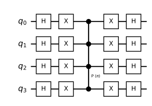{height=50% width=60%}

Con la función generadora del operador de Grover realizada, se procede con la resolución de los ejercicios.



## Ejercicio 1

El ejercicio pide implemente el algoritmo de Grover para dos oráculos (detectores).

### Inciso i)

El primer oráculo es un CCZ de 3 qubits. A continuación, se presenta su implementación:

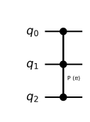{width=30%}

El algoritmo de Grover para el anterior oráculo, con una única iteración, se presenta a continuación:

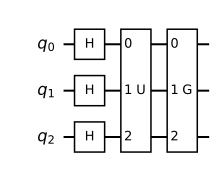{width=40%}

Para corroborar el correcto funcionamiento de la implementación, se realizó una simulación con 2000 shots. Se presenta el histograma con los resultados obtenidos:

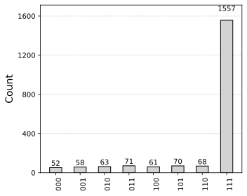{width=50%}

Como puede observarse, la implementación funciona correctamente, pues el resultado que se evidencia es 111, que corresponde con la solución del circuito.

### Inciso ii)

El segundo oráculo es un CCCCZ de 5 bits. A continuación, se presenta su implementación:

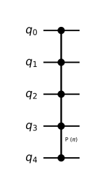{width=30%}

El algoritmo de Grover para el anterior oráculo, con una única iteración, se presenta a continuación se visualiza igual al algoritmo presentado en el inciso i). Por consiguiente, para no sobrecargar el informe, este no se muestra. La representación visual a un nivel alto de abstracción, para una única iteración, es siempre la misma. Lo que cambia es el oráculo y la cantidad de qubits sobre los cuales el operador de Grover opera.

Para corroborar el correcto funcionamiento de la implementación, se realizó una simulación con 2000 shots. Se presenta el histograma con los resultados obtenidos:

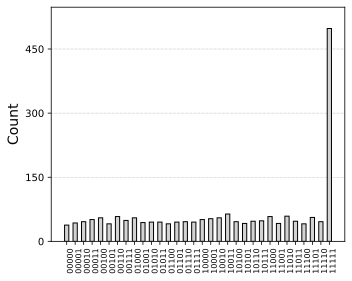{width=50%}

Como puede observarse, la implementación funciona correctamente, pues el resultado que se evidencia es 11111, que corresponde con la solución del circuito.



## Ejercicio 2

Se pide repetir los incisos anteriores pero variando el número de iteraciones. Debido a que no se especifica entre qué valores variarlo, se decidió arbitrariamente que la variación se realizará entre los valores del conjunto $\{1, 2, 3, 4, 5, 6, 7, 8, 9\}\$.

### Inciso i)

El oráculo de este ejercicio es CCZ, de tres bits. A continuación, se muestran los histogramas resultantes de la ejecución para las distintas variaciones:

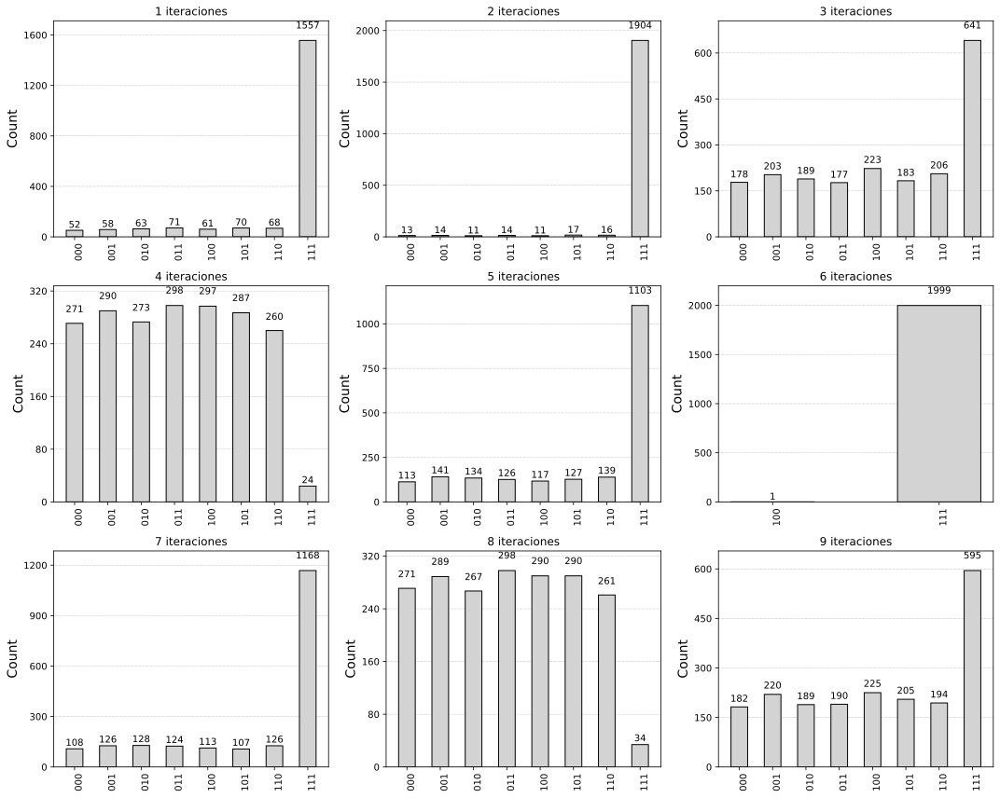{width=80%}

Como es posible observar, los mejores resultados se obtienen con seis iteraciones. No obstante, es necesario evaluar si un número tan elevado de iteraciones es conveniente. Esto debido a que cada iteración añade lógica al circuito que puede impactar en su tiempo de ejecución, compuertas nativas, costo, entre otros. Una iteración o dos iteraciones ya pueden considerarse lo suficientemente buenas y no se requiere llegar a seis para llegar a un resultado quasi-perfecto.

### Inciso ii)

El oráculo de este inciso es CCCCZ, de cinco bits, cuya implementación para una iteración ya se mostró en el ejercicio 1. A continuación, se muestran los histogramas resultantes de la ejecución para las distintas variaciones definidas:

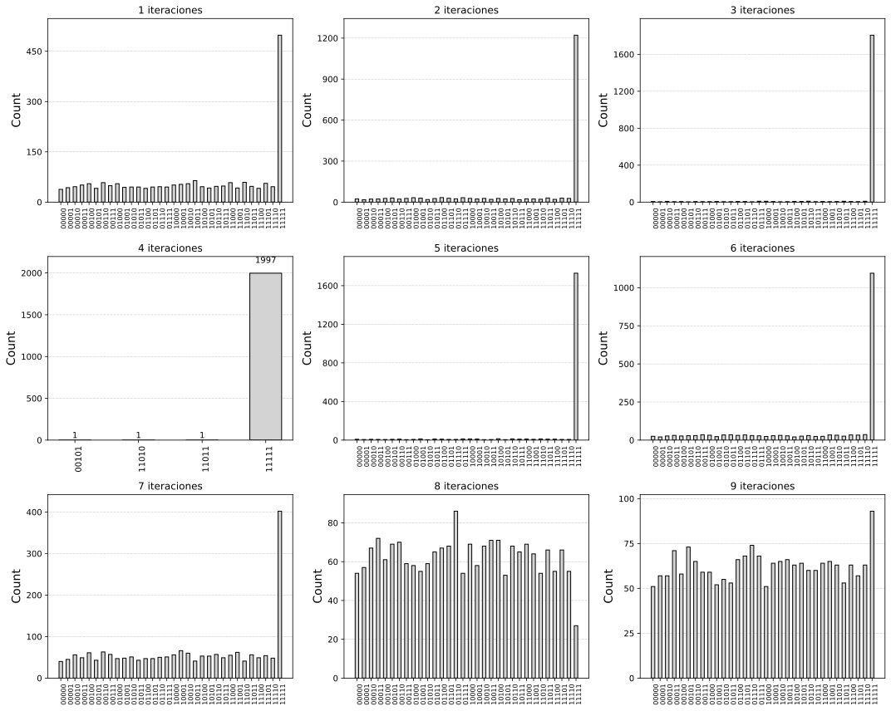{width=90%}

Los mejores resultados se obtienen para 4 (cuatro) iteraciones. Sin embargo, al igual que como se planteó anteriormente, ¿vale la pena añadir lógica adicional para mejorar un resultado que con un número menor de iteraciones ya es lo suficientemente bueno? Yo creo que no. Por ello, en base a los gráficos presentados anteriormente, determino que el número ideal de iteraciones Oráculo-Grover puede ser uno o dos, dependiendo del número de shots que se planean realizar.



## Ejercicio 3

Se pide implementar el algoritmo Grover para la función booleana $x_2’x_1.x_0$ y, posteriormente, determinar el número ideal de iteraciones Oráculo-Grover. A continuación, se presenta la implementación del oráculo:

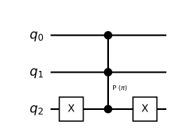{width=30%}

Luego, se construye el algoritmo de Grover, con el operador y el oráculo como cajas negras. A continuación, se visualizan los histogramas del resultado de este último para las nueve variaciones definidas en el ejercicio 2.

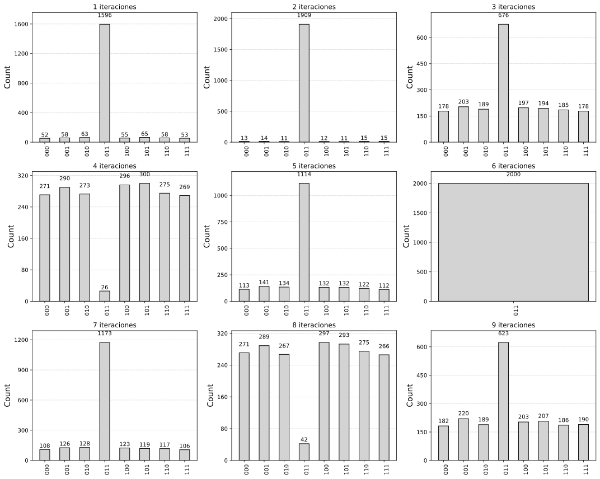{width=90%}

De acuerdo a los histogramas, el número perfecto de iteraciones es 6 (seis). No obstante, como se planteó ya en los anteriores ejercicios, no considero justificada la adhisión de tanta lógica adicional cuando el resultado con menos iteraciones ya es lo suficientemente bueno. Por ello, considero que el número ideal de iteraciones Oráculo-Grover es uno o dos (en base solo a los histogramas), dependiendo del número de shots que se esté dispuesto a realizar. Solo utilizaría seis instancias si el número de shots es muy reducido.

Teóricamente, con $N = 8$ estados (por tener 3 qubits, lo cual genera $2^3 = 8$ estados) y $M = 1$ solución, el ángulo de rotación por iteración cumple $\sin\theta = \sqrt{M/N} = 1/\sqrt{8}$, es decir, $\theta \approx 0{,}361$ rad. La probabilidad de medir el estado buscado tras $k$ iteraciones es $\sin^2((2k+1)\theta)$, que se maximiza para $k \approx \frac{\pi}{4}\sqrt{N/M} - \frac{1}{2} \approx 1{,}7$, es decir, $k = 2$ iteraciones, con una probabilidad de aproximadamente $94{,}5\%$ (con $k = 1$ es de aproximadamente $78{,}1\%$). Que $k = 6$ dé un resultado cercano al $100\%$ es una coincidencia numérica, ya que $13\theta \approx \frac{3\pi}{2}$, y no el óptimo del algoritmo. Esto respalda la elección visual de dos iteraciones como el número ideal.



## Ejercicio 4

Se pide implementar el algoritmo Grover para la función booleana $x2'x1'x0 + x2.x1.x0'$, determinar el número ideal de iteraciones Oráculo-Grover y justificar la respuesta.

Como primer paso, se define el oráculo que permita detectar la función. La función `x2’x1’x0 + x2.x1.x0’` vale 1 para dos entradas: $x_2x_1x_0 = 001$ y $x_2x_1x_0 = 110$. Al igual que en el ejercicio anterior, se utiliza un oráculo de fase: cada término se marca por separado, negando los qubits necesarios para convertir el estado buscado en $|111\rangle$, aplicando una CCZ y restableciendo luego los qubits. Como cada término corresponde a un estado distinto, el orden en que se aplican no importa. Así, la implementación del circuito propuesto es la siguiente:

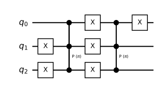{width=40%}

Considerando el anterior oráculo, se construye el algoritmo de Grover. A continuación, se presentan los histogramas resultantes de la ejecución de este último para las nueve variaciones definidas en el ejercicio 2:

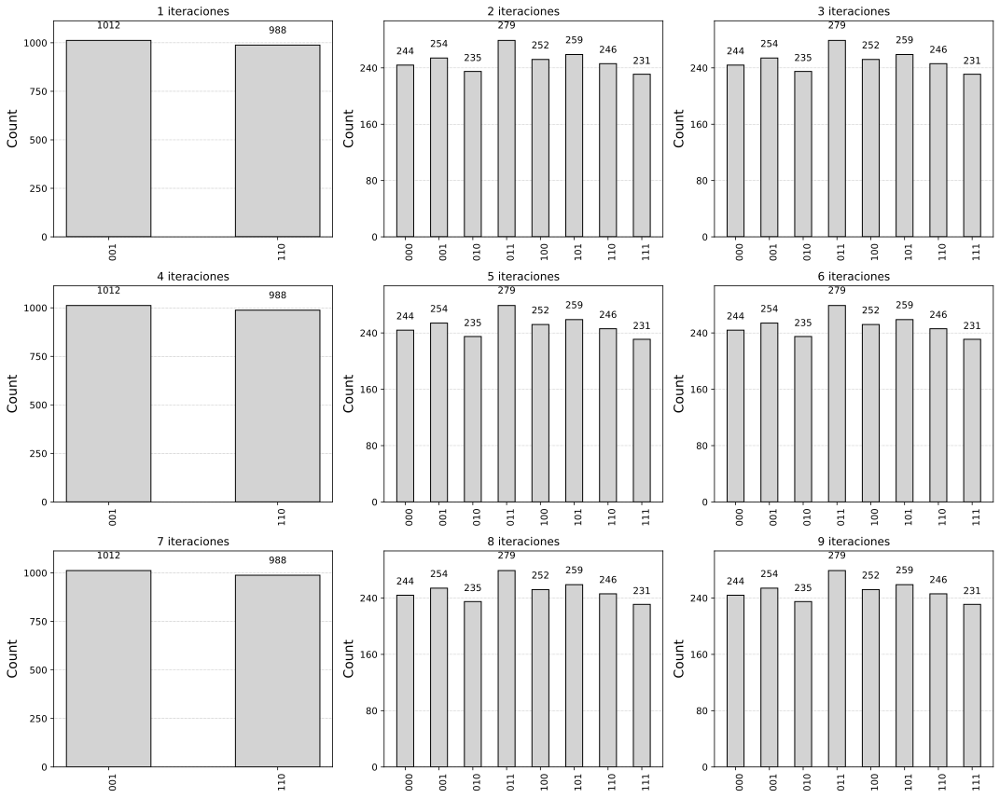{width=60%}

Una única iteración es suficiente para alcanzar resultados muy buenos. Añadir más iteraciones no solo empeora el resultado (salvo que el número de iteraciones pueda describirse mediante la fórmula $1 + 3k$, donde $k \geq 0$), sino que añade complejidad innecesaria al circuito.

Algo curioso sobre este ejercicio es que los gráficos se repiten cada 3 iteraciones. Esto: los gráficos 1, 4 y 7 son iguales; al igual que también lo son los gráficos 2, 5 y 8; y 3, 6 y 9. La función utilizada para estos gráficos es la misma que la utilizada para los anteriores. No hay reutilización de datos y se revisó el código para verificar que no se haya cometido ningún error. Incluso, se probó con otras semillas y aumentando el número de iteraciones a 25 y el patrón se continúa repitiendo.

Esto puede justificarse teóricamente. Con $N = 8$ estados y $M = 2$ soluciones, $\sin\theta = \sqrt{M/N} = 1/2$, por lo que $\theta = \frac{\pi}{6}$. La probabilidad de medir un estado buscado tras $k$ iteraciones es $\sin^2\left((2k+1)\frac{\pi}{6}\right)$. Esta vale exactamente $1$ cuando $(2k+1)\frac{\pi}{6} = \frac{\pi}{2} + m\pi$, es decir, para $k = 1 + 3m$, que es la fórmula que se dedujo a partir de los gráficos. Además, al aumentar $k$ en 3 el argumento aumenta en $\pi$ y el seno al cuadrado no cambia, lo que explica que los gráficos se repitan cada 3 iteraciones. Para $k = 2$ y $k = 3$ la probabilidad es $0{.}25$, lo cual coincide con los histogramas obtenidos. El número ideal de iteraciones es, entonces, $k = 1$, ya que alcanza el $100\%$ con el menor costo.



# Conclusiones

A lo largo del desarrollo de estos trabajos prácticos, se profundizó en dos algoritmos de la computación cuántica: la Estimación de Fase Cuántica (QPE) y la búsqueda de Grover. Su implementación en Qiskit permitió observar fenómeno como el _phase kickback_ (y el efecto de la fase global sobre este), la interferencia constructiva y destructiva de amplitudes, y el carácter periódico de las rotaciones.



# Transparencia

Se utilizó IA generativa (en particular, Claude, DeepSeek y Gemini) para:

- profundizar sobre algunos conceptos (por ejemplo, el _phase kickback_);
- generar el código encargado de generar las tablas utilizadas en el informe;
- generar el código encargado de agrupar los distintos circuitos y evaluaciones en un único mosaico; y
- realizar una revisión general del práctico y del informe en busca de _bugs_ que hayan pasado desapercibidos en el código y errores ortográficos en las redacciones.

**Exceptuando lo mencionado, el resto de la resolución, tanto en lo que respecta a las _notebooks_ como al informe, en cuanto código, conclusiones y redacción, son propias**.



# Referencias

[1] Materiales de la Cursada.

[2] M. A. Nielsen and I. L. Chuang, _Quantum Computation and Quantum Information: 10th Anniversary Edition_, Cambridge University Press, 2010.

[3] “Qiskit Documentation”, IBM Quantum, [Online]. Disponible en: [https://quantum.cloud.ibm.com/docs/es](https://quantum.cloud.ibm.com/docs/es).

## Recursos específicos

- Video de la clase de QPE: [https://www.youtube.com/watch?v=BeXcnjBtEto](https://www.youtube.com/watch?v=BeXcnjBtEto)
- _Phase kickback_: [https://en.wikipedia.org/wiki/Phase_kickback](https://en.wikipedia.org/wiki/Phase_kickback)
- Estimación de fase cuántica: [https://es.wikipedia.org/wiki/Algoritmo_cu%C3%A1ntico_de_estimaci%C3%B3n_de_fase](https://es.wikipedia.org/wiki/Algoritmo_cu%C3%A1ntico_de_estimaci%C3%B3n_de_fase)
- Algoritmo de Grover: [https://es.wikipedia.org/wiki/Algoritmo_de_Grover](https://es.wikipedia.org/wiki/Algoritmo_de_Grover)

